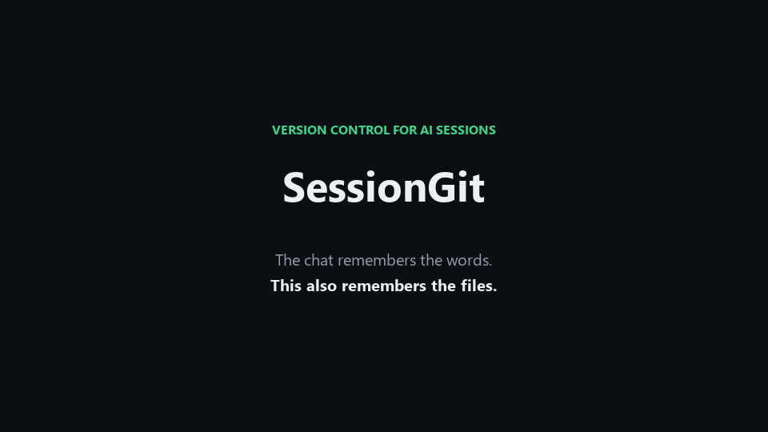

# SessionGit

Version control for your AI conversations. Because "what did we work on yesterday?" shouldn't require scrolling through 50 chat threads.

**Current version**: v0.3.0

## The Problem

You spend 2 hours debugging with your AI assistant. Find a solution. Next day: "wait, what files did we change?" The conversation history is there but the code state is gone. Or you switched git branches. Or you're on a different machine.

SessionGit fixes this by storing your AI conversations alongside the actual file content at that moment in time.

**Works with:** Claude Desktop, ChatGPT, Cursor, GitHub Copilot, or any AI assistant via the Python API.

## What It Does

- Saves every conversation turn with full context
- Stores actual file content (not just references)
- Works across git branches, different machines, whatever
- Search through past conversations
- Resume old sessions with complete context
- Universal: works with any AI provider

Think of it as Git, but for AI pair programming sessions instead of just code.

## Demo



*Each turn stores the conversation, the file content, and the working state. Search it later and resume with the files still attached.*

## Installation

```bash
# Clone and install
git clone https://github.com/cliffhangerchaos-cloud/sessiongit.git
cd sessiongit
pip install -e .

# Initialize storage
sessiongit init
```

The `pip install -e .` command automatically installs all dependencies from `pyproject.toml` (including MCP for Claude Desktop integration).

## Quick Example

```python
from sessiongit import SessionManager
from pathlib import Path

# Create a session
manager = SessionManager(Path.home() / ".sessiongit")
session = manager.create_session(
    title="Debugging auth issue",
    provider="openai",  # or "anthropic", "cursor", etc.
    model="gpt-4",
    source="api"
)

# Save a conversation turn
turn = manager.commit_turn(
    session=session,
    user_message="Help me fix the JWT timeout",
    assistant_message="Let me check your auth code...",
    model="gpt-4",
    provider="openai"
)

# Load it later
loaded = manager.load_session(session.metadata.session_id, load_all_turns=True)
```

## CLI Commands

```bash
# List your sessions
sessiongit list

# Show details
sessiongit show sess_20261103

# Search across all conversations
sessiongit search "JWT timeout"

# Export/import sessions
sessiongit export sess_20261103 -o backup.zip
sessiongit import backup.zip

# Check storage stats
sessiongit status
```

## Integrations

### Claude Desktop (MCP)

Auto-track conversations in Claude Desktop:

1. Install MCP: `pip install mcp`
2. Edit your Claude Desktop config (`claude_desktop_config.json`):

```json
{
  "mcpServers": {
    "sessiongit": {
      "command": "python",
      "args": ["-m", "sessiongit.mcp_server"]
    }
  }
}
```

3. Restart Claude Desktop

See [MCP_SERVER_SETUP.md](MCP_SERVER_SETUP.md) for details.

### ChatGPT / Cursor / Other AI Tools

Use the Python API to manually save conversations:

```python
from sessiongit import SessionManager
from pathlib import Path

# After each AI interaction, commit it
manager = SessionManager(Path.home() / ".sessiongit")
session = manager.create_session(
    title="Current project",
    provider="openai",  # or whatever you use
    model="gpt-4",
    source="chatgpt-web"  # or "cursor", "copilot", etc.
)

# Then commit each exchange
manager.commit_turn(
    session=session,
    user_message="Your prompt",
    assistant_message="AI response",
    model="gpt-4",
    provider="openai"
)
```

**Future:** We're working on integrations for ChatGPT web, Cursor, and other AI tools. Contributions welcome!

## How It Works

SessionGit uses content-addressed storage (same idea as Git objects):

```
~/.sessiongit/
  objects/              # Files stored by SHA256 hash
    ab/cd123...        # Deduplicated + compressed
  
  sessions/
    sess_abc123/
      meta.json        # Session info
      turns/           # Conversation history
        0001.json      # Turn 1
        0002.json      # Turn 2
```

Each turn stores:
- User prompt + AI response
- File operations with full content
- State tracking (goals, decisions, next steps)
- Workspace snapshot

Key features:
- **Deduplication**: Same file stored multiple times? Only saved once
- **Compression**: Average session ~200-500KB
- **Snapshots**: Full state every 10 turns for fast loading
- **Privacy**: Optional secret redaction for API keys, tokens, etc.
- **Provider-agnostic**: Works with any AI (OpenAI, Anthropic, local models, etc.)

## Storage Efficiency

A typical 50-turn coding session:
- Metadata: ~150KB
- File objects: ~9KB (after dedup)
- Snapshots: ~75KB
- Total: ~234KB (or ~120KB compressed)

Store hundreds of sessions without worrying about disk space.

## Current Status

What works:
- Core storage engine (content-addressed, compressed, deduplicated)
- Python API for programmatic use
- Full CLI with search, export/import, secret redaction
- File tracking with diffs
- Git repo detection (but doesn't require git)
- MCP server for Claude Desktop
- Cross-platform (Windows, macOS, Linux)
- Works with any AI provider via API

What doesn't:
- Auto-capture for ChatGPT/Cursor (use Python API manually)
- Browser extensions
- IDE integrations (except via manual API use)

## Supported AI Providers

SessionGit is **provider-agnostic**. It works with:

- ✅ **OpenAI** (GPT-4, ChatGPT) - via Python API
- ✅ **Anthropic** (Claude) - via Python API or MCP
- ✅ **Cursor** - via Python API
- ✅ **GitHub Copilot** - via Python API
- ✅ **Local models** (Ollama, LM Studio) - via Python API
- ✅ **Any other AI** - just use the Python API

The core tracks conversations, not specific to any provider.

## FAQ

**Why not just use git?**

Git tracks code. This tracks conversations. You lose context when your AI says "I fixed the auth bug" and you can't remember what state the code was in or what the actual conversation was.

**Does it only work with Claude?**

No! It works with **any AI provider**. Claude Desktop has built-in MCP support for auto-tracking, but you can use the Python API with ChatGPT, Cursor, Copilot, or any other AI tool.

**Do I need git?**

Nope. SessionGit works standalone. If you're in a git repo it'll track that info, but it stores file content regardless.

**How much space does it use?**

Not much. Typical session is 200-500KB. Thousands of sessions = few hundred MB. Deduplication helps a lot.

**What about API keys and secrets?**

Built-in secret redaction. Enable it with `sessiongit config set enable_redaction true` and it'll automatically scrub common patterns before storage.

**Can I move sessions between machines?**

Yes. Either copy the session folder or use `sessiongit export/import`. Sessions are self-contained.

## Development

```bash
# Install dev dependencies
pip install -e ".[dev]"

# Run tests
pytest tests/ -v

# Format code
black src/
ruff check src/
```

Note: ~5 tests fail on Windows due to path/encoding quirks. Known issue.

## Contributing

Found a bug? Want a feature? PRs welcome. See [CONTRIBUTING.md](CONTRIBUTING.md).

Areas that need help:
- ChatGPT web integration
- Cursor integration
- VSCode extension
- Browser extension
- Better search implementation

## Roadmap

v0.4.0:
- ChatGPT web integration
- Cursor integration
- Session tags and categories
- Performance improvements

v0.5.0:
- Browser extension
- VSCode extension
- Team features (shared repos)
- Advanced search (semantic, fuzzy)

## Why I Built This

I pair program with AI daily (Claude, ChatGPT, Cursor). I kept losing track of what we'd worked on, especially multi-day debugging sessions. Chat history exists but doesn't capture file state. Git captures file state but not the conversation.

This bridges that gap, for **any AI tool you use**.

## License

MIT - see [LICENSE](LICENSE)

## Support

- Issues: https://github.com/cliffhangerchaos-cloud/sessiongit/issues
- Examples: See [examples/](examples/) directory

Built for developers who use AI daily and got tired of losing context.
